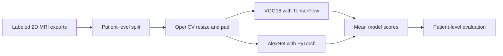
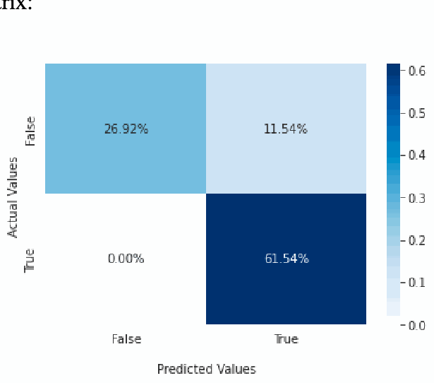
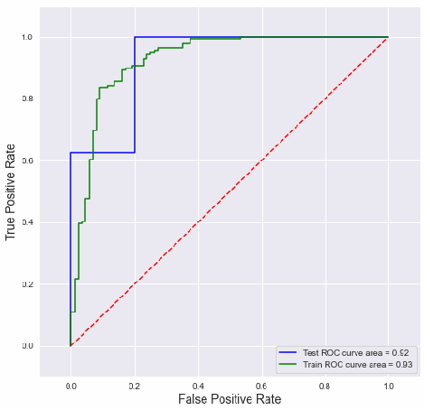
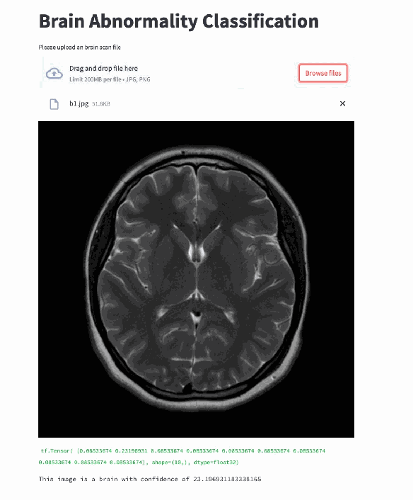

# Big Brain · MRI Classification

A research rebuild of a binary brain MRI classification project. It trains VGG16 with TensorFlow and AlexNet with PyTorch, combines their scores, and evaluates both models and the ensemble on held-out patients. OpenCV handles preprocessing and optional training augmentation.



I verified the rebuild end to end using synthetic images, including training both models, evaluation, inference, and latency measurement. A real MRI dataset and the original baselines are needed to assess accuracy or measure changes in false positives and inference time.

## Original research showcase

The original BigBrain project used a two-stage workflow. The first classifier screened for brain images. The second classified brain images as normal or abnormal. The paper describes roughly 720 images for the screening task and 400 images for the second task, with T1-weighted, T2-weighted, and FLAIR scans in the brain image collection. The team manually labeled images in a Jupyter notebook and explored OpenCV resizing, median blur, bilateral filtering, and intensity histograms. [Read the original paper (PDF)](https://drive.google.com/file/d/1U5X72FCQSGSLBYWwEU2c2pfZs33EsYRX/view)

The custom CNN used four 3×3 convolution layers with 32, 64, 64, and 128 filters, followed by a dense classification head. The design used max pooling and dropout. A separate variant added training-time translation, flipping, rotation, contrast adjustment, and zoom. See Section IV for the workflow and Section V for the model specifications.

| Original model | Accuracy reported in Table 1 |
| --- | ---: |
| Custom CNN | 92.31% |
| ANN | 80.77% |
| CNN with augmentation | 80.77% |
| AlexNet | 69.23% |
| VGG16 | 61.54% |

Table 1 attributes 92.31% to the **custom CNN**. Figure 8's diagonal sums to 88.46%. The paper does not reconcile the figures or establish that they came from the same evaluation run. These are historical results. The VGG16–AlexNet ensemble in this repository was verified on synthetic images.

### Confusion matrix and ROC curve



*Figure 8 from the original paper. Rows show actual labels and columns show predicted labels.*



*Figure 9 from the original paper. ROC curves plot sensitivity against false-positive rate across decision thresholds.*

### Original web prototype



*Figure 10 from the original paper. The team used this prototype to demonstrate image upload and classification.*

## Setup

Use Python 3.11 or 3.12. A GPU is optional for the smoke run and helpful for full training.

```sh
python3 -m venv .venv
source .venv/bin/activate
python -m pip install -r requirements.txt
```

## Run the complete workflow with synthetic data

The synthetic images contain simple shapes. They test the software and cannot establish MRI performance.

```sh
python big_brain.py synthetic data/demo
python big_brain.py split data/demo/images.csv data/demo/split.csv
python big_brain.py train data/demo/split.csv runs/demo --model vgg --epochs 1 --batch 4
python big_brain.py train data/demo/split.csv runs/demo --model alex --epochs 1 --batch 4
python big_brain.py evaluate data/demo/split.csv runs/demo
python big_brain.py predict runs/demo data/demo/synthetic-1-00.png
python big_brain.py benchmark runs/demo data/demo/synthetic-1-00.png
```

## Suggested dataset

[Gazi Brains 2020 on Kaggle](https://www.kaggle.com/datasets/gazibrains2020/gazi-brains-2020) contains MRI studies from 100 subjects, evenly divided between high-grade glioma and controls. The subject grouping makes it possible to keep every slice from one person in the same split. [Dataset paper](https://pmc.ncbi.nlm.nih.gov/articles/PMC12192951/)

For a first run, choose one MRI sequence available in both groups and apply the same axial slice selection and intensity conversion to all subjects. Export 8-bit PNGs and use the dataset's subject identifier as `patient_id`. Assign `label=1` to high-grade glioma cases and `label=0` to controls. Build the CSV described below, then use the same patient split for both models.

Report the task as **high-grade glioma vs. control on Gazi Brains 2020**. The verified run in this repo used synthetic images. Gazi Brains is the proposed dataset for a future real-data evaluation. Download it from the source under its terms and keep the scans outside version control.

## Train with your own data

Use a dataset you are authorized to use with both tumor-positive and tumor-negative patients. Supply comparable, de-identified 2D PNG exports from a consistent MRI sequence and view. A positive label refers to the patient, so every slice for that patient has the same label. The loader expects 8-bit exports. Prepare volumetric DICOM or NIfTI studies upstream using a documented extraction and intensity-windowing protocol.

Create a CSV with these columns. Paths can be relative to the CSV.

```csv
path,patient_id,label
images/p001-01.png,p001,0
images/p001-02.png,p001,0
images/p002-01.png,p002,1
```

Run `split` once, then reuse the resulting manifest across every experiment. The split is stratified by patient label and keeps all slices from a patient together. For an existing study split, supply the same CSV with an additional `split` column containing `train`, `validation`, or `test`. Use stable patient identifiers and remove re-exported duplicates upstream. Train the two models into the same run directory. Add `--imagenet` for pretrained backbones with a trainable classification head and `--augment` for small rotations, scale changes, and brightness changes during training only.

## Read the results

- Training keeps the checkpoint with the highest validation patient ROC AUC.
- Evaluation averages slice scores per patient and gives the two models equal weight in the ensemble. It selects each decision threshold on validation patients at the requested sensitivity target, then reports accuracy, sensitivity, specificity, false-positive rate, ROC AUC, average precision, and confusion counts on test patients. Results go to `report.json`.
- To measure the effect of augmentation, train matched runs with and without `--augment`. Use the same split, seeds, initialization mode, and evaluation protocol. Compare sensitivity alongside false positives.
- Benchmarking warms up both networks, then reports median and p95 batch-one latency. It excludes image decoding and checkpoint loading. Compare runs on the same hardware and software with the same number of repetitions.
- The inference command reports scores for one slice. Evaluation thresholds apply to patient averages. Scores are uncalibrated research outputs and are not intended for clinical diagnosis.

Model references: [VGG16 in TensorFlow](https://www.tensorflow.org/api_docs/python/tf/keras/applications/VGG16) and [AlexNet in TorchVision](https://docs.pytorch.org/vision/stable/models/alexnet.html).
